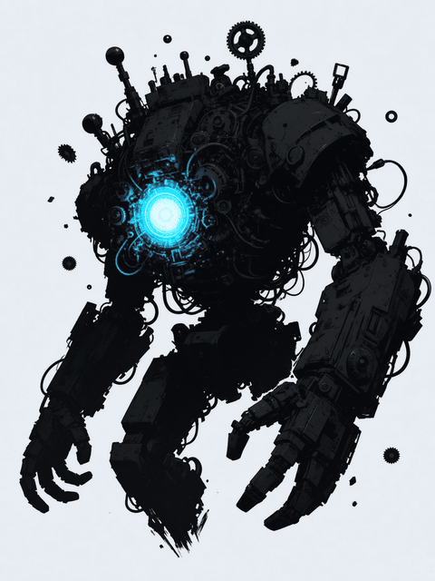

# Artificer

<p align="center">
  <picture>
    <source media="(prefers-color-scheme: dark)" srcset="assets/readme/artificer-readme-dark-480x640.png">
    <source media="(prefers-color-scheme: light)" srcset="assets/readme/artificer-readme-light-480x640.png">
    
  </picture>
</p>
<p align="center">Hero art originally generated with Grok Imagine; refined by TactCode.</p>

Artificer is a local LLM inference engine written in Rust. It loads **GGUF** models, runs them on the
**CPU** (AVX2 / AVX-512 kernels chosen at run time) or, optionally, on an **NVIDIA GPU via CUDA**, and serves
them through an **OpenAI-compatible HTTP API** and **MCP**. It is one binary (`artificer`). It needs no Python
or background services, and it does not download models: bring your own GGUF.

Repository: <https://github.com/itm-tactcode/artificer>

- GGUF v2/v3 loader using `mmap` (weights are not copied onto the heap)
- Quants: F32/F16/BF16, Q4_0/Q4_1, Q5_0/Q5_1, Q8_0, Q2_K–Q6_K
- Tokenizers: SentencePiece unigram and GPT-2 byte-level BPE; Jinja chat templates read from the GGUF
- Sampling: greedy, temperature, top-k, top-p, seed, stop strings
- Streaming emits whole UTF-8 characters: a multi-byte character split across tokens (byte-fallback or
  byte-level BPE pieces) is held until it is complete, so CLI, SSE and MCP output has no stray U+FFFD
- Server: `GET /health`, `GET /v1/models`, `POST /v1/models/load`, `POST /v1/chat/completions` (SSE with
  `"stream": true`, OpenAI `tools` / `tool_calls`), `POST /v1/chat/cancel`, and MCP at `POST /mcp`
- MCP over stdio (`artificer mcp`), tools `chat` and `complete`
- `artificer perplexity`: same method as llama.cpp `llama-perplexity` (default mode, pinned `8642541b`)

## New in 0.1.0

0.1.0 is the first release. It ships:

- the `artificer` CLI (`run`, `bench`, `perplexity`, `serve`, `mcp`) for Linux x86_64, Windows x86_64 and macOS
  aarch64. Linux CUDA is the only GPU build in 0.1.0; the Windows and macOS downloads run on the CPU.
- the desktop app (Tauri 2) as a download for all three OS. It is new in 0.1.0, runs on the CPU and starts its own
  local server (or reuses an `artificer serve` already running on port 8080); see [Install a release binary](#install-a-release-binary) for what each OS needs.

Please report bugs and problems in the repository's GitHub issues:
<https://github.com/itm-tactcode/artificer/issues>. Include the OS, the CPU, the asset you downloaded, the model's
architecture and the exact error text.

## Architecture support

RoPE layout is chosen per architecture and follows llama.cpp `llama_model_rope_type` (pinned v0.8.0,
`8642541b`; table in `crates/core/src/config/arch.rs`). The loader accepts these `general.architecture` values:

| Arch | RoPE | CPU | CUDA | Checked against a model |
|---|---|---|---|---|
| `llama`, `llama4`, `deci`, `deepseek` (dense), `baichuan`, `internlm2`, `minicpm`, `xverse`, `olmo`, `command-r` | NORM | yes | yes | `llama` (a small llama-architecture GGUF) |
| `nemotron_h` (Mamba-2 SSM + attention hybrid) | none | yes | yes | Nemotron-3-Nano 4B |
| `qwen2`, `qwen3` | NEOX (+ per-head q/k RMSNorm on `qwen3`) | yes | **no** (CPU only) | Qwen3-0.6B and Qwen2.5-0.5B-Instruct Q8_0 vs llama.cpp, CPU |
| `qwen`, `gemma`, `gemma2` (sliding window), `gemma3`, `nemotron` | NEOX | yes | **no** (CPU only) | no: NEOX per llama.cpp, untested |
| `phi3`, `stablelm`, `starcoder2`, `openelm`, `exaone` | NEOX | yes | **no** (CPU only) | no: **NEOX per llama.cpp, untested** |
| `olmoe` (MoE) | NEOX (+ full-width q/k RMSNorm) | **experimental**, needs `--experimental-moe` | **no** | OLMoE-1B-7B-0924-Instruct Q4_K_M vs llama.cpp, CPU; has not passed all quality checks |
| `qwen2moe` (MoE + shared expert) | NEOX | **experimental**, needs `--experimental-moe` | **no** | Qwen1.5-MoE-A2.7B Q4_K_M vs llama.cpp perplexity, CPU; token and routing checks not scored |

"Untested" means no model of that architecture has been run against a reference. These arches were
switched from NORM to NEOX RoPE to match llama.cpp; `phi3` and `stablelm` use partial rotary. Treat their
output as unverified.

**CUDA is off for NEOX-RoPE architectures and MoE.** With `--backend cuda`, a model that uses NEOX
RoPE, has q/k-norm tensors (`attn_q_norm` / `attn_k_norm`) or has MoE router tensors (`ffn_gate_inp`) fails with
an error naming the architecture and the reason (`crates/core/src/model.rs`, `cuda_refusal_reason`). `run`, `bench`
and `perplexity` print it as:

```text
error: failed to load model `<path>`: backend: the CUDA backend does not support `<arch>` models yet: <reasons>. NEOX-RoPE architectures and MoE models run on the CPU only; use the CPU backend (--backend cpu).
```

For a model with MoE layers the error gets one more sentence at the end. For `olmoe` the full line is:

```text
error: failed to load model `<path>`: backend: the CUDA backend does not support `olmoe` models yet: it uses NEOX-style RoPE, it has q/k-norm tensors (attn_q_norm / attn_k_norm), it has MoE layers (ffn_gate_inp). NEOX-RoPE architectures and MoE models run on the CPU only; use the CPU backend (--backend cpu). MoE is experimental and CPU-only: run it with --backend cpu --experimental-moe.
```

Run those models with `--backend cpu`. A CUDA port with its own CPU-vs-CUDA parity test may come in a future release (no date).

**MoE is experimental and off by default.** Two MoE families are implemented, both experimental and CPU only:
`olmoe` (OLMoE; softmax top-k router) and `qwen2moe` (Qwen1.5-MoE; softmax top-k router plus
a sigmoid-gated shared expert). Every command that loads a model needs `--experimental-moe` to load either of them:
`run`, `bench`, `perplexity`, `serve` (its flag also covers `POST /v1/models/load`) and `mcp` (both `chat` and
`complete`). With the flag, Artificer prints one warning and runs the model:

```text
experimental MoE: `olmoe` loaded with --experimental-moe; output is not validated
```

`run`, `bench` and `perplexity` print it to stderr as `warning: ...`; `serve` and `mcp` log it at WARN level. Without
the flag the model is refused with:

```text
`olmoe` is an MoE model; MoE support is experimental: pass --experimental-moe to load it
```

`run`, `bench` and `perplexity` prefix that with ``failed to load model `<path>`:``, so the line on stderr is
``error: failed to load model `<path>`: `olmoe` is an MoE model; ...``. `POST /v1/models/load` returns
`failed to load model: <text>`. For Qwen1.5-MoE the warning and the refusal name `qwen2moe` instead of `olmoe`,
e.g. `` `qwen2moe` is an MoE model; MoE support is experimental: pass --experimental-moe to load it ``. Other MoE
architectures (`qwen3moe`, `deepseek2`, `deepseek` with `expert_count`) are still rejected at load. **CUDA refuses MoE
models (`olmoe` and `qwen2moe`) with or without the flag**; its error ends with
`MoE is experimental and CPU-only: run it with --backend cpu --experimental-moe.` An MoE family that passes its quality
checks will be listed here as supported and will not need the flag.

**OLMoE and runs of spaces.** OLMoE's vocabulary has dedicated tokens for runs of spaces. Raw text (`run --raw`,
`perplexity`) is split on them the same way llama.cpp does. Chat message text (`run` without `--raw`,
`/v1/chat/completions`, MCP `chat`) is tokenized as plain text, so a message that contains two or more spaces in a
row can get different token IDs from llama.cpp, and the output can differ.

## Platforms and requirements

**CPU requirement: x86_64 builds need AVX2 (x86-64-v3: Intel Haswell / AMD Zen 1 or newer).** A portable
binary is built with `RUSTFLAGS="-C target-cpu=x86-64-v3"`; it crashes with an illegal instruction on CPUs
without AVX2. AVX-512 / VNNI kernels are still picked at run time when the CPU has them
(`crates/core/src/quant/simd.rs`). There is no x86-64-v2 (non-AVX2) build.

How the target CPU is set:

- [`.cargo/config.toml`](.cargo/config.toml) sets `[build] rustflags = ["-C", "target-cpu=native"]`, so a plain
  `cargo build` (and `scripts/install.sh`) produces a binary tuned for, and only safe on, the build machine.
- For a binary you copy to other machines, set `RUSTFLAGS`, which replaces the config value entirely:
  `RUSTFLAGS="-C target-cpu=x86-64-v3" cargo build --release --locked -p artificer-cli`.
- CI ([`.github/workflows/build.yml`](.github/workflows/build.yml)) sets `RUSTFLAGS: "-C target-cpu=x86-64-v3"`
  on every x86_64 job (CLI and desktop app) and `-C target-cpu=apple-m1` on macOS.

| Platform | CPU | CUDA | CI |
|---|---|---|---|
| Linux x86_64 | Ubuntu 22.04+ or equivalent (glibc ≥ 2.34) | Supported (optional `cuda` feature). Needs the NVIDIA driver (`libcuda.so.1`) and, at run time, `libcudart` and `libcublas` (`.so.13`, `.12` or `.11`) and NVRTC (`libnvrtc.so.13` or `.12`). Not needed to build. Tested on one local NVIDIA laptop GPU only | CPU: build + tests on every push. CUDA: compile only on every push (no GPU, no CUDA tests run) |
| Windows x86_64 | Built and tested by CI only; **not verified on a Windows machine**. RAM is detected (total and available), so `--ctx` is shrunk to fit RAM as on Linux; peak RSS is Linux-only, so `bench` reports no RSS | **Not supported** (the CUDA loader looks for Linux `.so` names only) | CPU: build + tests on every push |
| macOS aarch64 | **Unverified.** No NEON kernels yet, so the CPU kernels are scalar. RAM is detected (total only, so `--ctx` is fitted to total RAM); peak RSS is Linux-only, as on Windows | **Not supported** (no CUDA, no Metal) | Build + tests on **manual dispatch only**; not run on the current commit |
| Other (Linux aarch64, macOS x86_64, 32-bit) | Not built or tested | - | none |
| Desktop app (`desktop/`, Tauri 2) | Release download on all three OS: Linux x86_64 `.tar.gz` (Ubuntu 22.04+ with WebKitGTK 4.1), Windows x86_64 `.exe` (WebView2), macOS aarch64 unsigned `Artificer.app`. New in 0.1.0 | - (talks to `artificer serve`, which picks the backend) | Linux: build + desktop tests + `.tar.gz` on every push (Ubuntu 22.04 runner). Windows: build + zip on every push. macOS: `Artificer.app` on manual dispatch only |

**CUDA is loaded at run time.** The `cuda` feature adds no crates and no build script: `libcudart`, `libcublas`,
NVRTC and the driver are opened with `dlopen`, and the kernels in `crates/core/src/backend/cuda_kernels.cu` are
compiled by NVRTC when the device starts. No CUDA toolkit or `nvcc` is needed to build. Without a GPU or the
libraries, `--backend cuda` fails with an error; `serve --cpu-fallback` serves on the CPU instead.

Building from source needs Rust and the committed `Cargo.lock`. The toolchain is pinned to Rust 1.100.0 via `rust-toolchain.toml` (CI uses the same version); no MSRV is declared.

## Install a release binary

0.1.0 ships the `artificer` command-line binary and the desktop app for Linux, Windows and macOS. Linux CUDA is the only GPU build; the Windows and macOS downloads run on the CPU. Each release has one CLI binary and one desktop download per platform and a `SHA256SUMS` file with the SHA256 checksum of every asset. The
release notes record each asset's source commit, Rust toolchain (`rustc -V`) and checksum.

- **Where the assets come from:** the Linux CLI binary is built locally with the optional `cuda` feature. The Windows
  and macOS CLI binaries and all three desktop downloads are built by CI ([`build.yml`](.github/workflows/build.yml));
  the Windows and macOS builds are CPU-only.
- **Linux:** the asset is built with the `cuda` feature, and `--backend cuda` needs the NVIDIA libraries listed above.
  The release notes say whether that asset also runs on a machine with no CUDA libraries, or whether a separate
  CPU-only Linux asset is provided for that.

**Check the download** against `SHA256SUMS` (in the folder you downloaded to):

```bash
sha256sum -c SHA256SUMS --ignore-missing      # Linux: prints "<file>: OK" for each asset you have
shasum -a 256 <file>                          # macOS: compare with the line for <file> in SHA256SUMS
```

```powershell
Get-FileHash .\<file> -Algorithm SHA256       # Windows: compare Hash with SHA256SUMS (case does not matter)
```

**The binaries are not signed**, so the OS warns the first time:

- **macOS (Gatekeeper, macOS 15 Sequoia and later):** open the file once (macOS blocks it), then go to
  **System Settings → Privacy & Security** and click **Open Anyway**, and confirm; or remove the quarantine flag
  with `xattr -d com.apple.quarantine <file>`. Run `chmod +x <file>` if needed.
- **macOS desktop app:** `Artificer.app` is unsigned (ad-hoc signature only). Same steps: open it once, then
  **System Settings → Privacy & Security** → **Open Anyway**; or run `xattr -dr com.apple.quarantine Artificer.app`.
- **Windows (SmartScreen):** on the "Windows protected your PC" screen, click **More info**, then **Run anyway**.
- **Linux:** `chmod +x <file>`; there is no signature check.

**Desktop app.** The desktop app (Tauri 2, `desktop/`) is a release download on all three OS. In 0.1.0 it runs on
the CPU only and starts its own local server: pick (or paste the path of) a `.gguf` file and the app runs the Artificer
server inside the app, on a free port on `127.0.0.1`, with that file; it stops that server when you quit. You do not
need to start `artificer serve` first. If an Artificer server with a model loaded already answers on
`http://127.0.0.1:8080`, the app uses that one instead and leaves it running when you quit.

- **GPU on Linux:** the desktop app has no GPU option of its own. Start the server on the GPU yourself, on the default
  port, e.g. `artificer serve path/to/your-model.gguf --backend cuda`; the app finds it on `127.0.0.1:8080` and
  reuses it.
- **Windows tip:** if `artificer serve` stops with
  `error: could not listen on 127.0.0.1:8080 (… (os error 10013)). The port may be reserved by Windows or need more privileges; try --port <N>.`,
  Windows has reserved port 8080 (error 10013): rerun with another port, e.g. `--port 8081`. The desktop app does not
  need 8080 (its own server uses a free port), but it only reuses a server on 8080.
- **Linux tip:** if CHANGE does nothing (no file chooser opens), paste the full path of the `.gguf` file into the path
  box.

What each OS needs at run time:

- **Linux x86_64:** Ubuntu 22.04 or later (or a distribution with glibc ≥ 2.34) and WebKitGTK 4.1:
  `sudo apt install libwebkit2gtk-4.1-0` (this also pulls in GTK 3). The download is a plain `.tar.gz`:
  `bin/artificer-desktop`, `share/applications/io.tactcode.artificer.desktop`, the app icon in 7 sizes under
  `share/icons/hicolor/<n>x<n>/apps/artificer.png` (16 to 512), `install.sh` / `uninstall.sh`, README, licenses and
  notices. `./install.sh [--prefix DIR]` installs the app, launcher entry and icons under `~/.local` (no build, no
  root); `./uninstall.sh [--prefix DIR]` removes exactly those files. You can also run `bin/artificer-desktop` in place.
- **Windows x86_64:** a zip with `artificer-desktop.exe` (plus README, licenses, notices). It needs the Microsoft Edge
  WebView2 Runtime, which is preinstalled on Windows 11 and current Windows 10; otherwise install the WebView2 Runtime
  from Microsoft. CPU only.
- **macOS aarch64:** a zip with the unsigned `Artificer.app` (plus licenses and notices); unzip it, move it to
  Applications and follow the Gatekeeper step above. CPU only.

From a source checkout, `scripts/install.sh` builds the CLI and the desktop app and installs both (Linux; see
[Build](#build)).

- **Known issue (desktop app and MoE):** the desktop app has no `--experimental-moe` option of its own, and its
  built-in server refuses MoE models. To use one from the desktop, start `artificer serve --experimental-moe` on the
  default port 8080 with a model loaded; the app reuses it. Otherwise the desktop shows the refusal as a model load
  error.

## Numerics

On the CPU, Q6_K matmuls with K < 8192 or N > 8192 (e.g. large LM heads) take f32 activations directly; larger-K Q6_K matmuls quantize activations to Q8_K.
This is a speed/accuracy tradeoff; llama.cpp quantizes activations on these paths more often, so logits can differ slightly between the two engines.
On the CPU the KV cache is f32 by default (llama.cpp defaults to f16); `--kv-f16` stores it in f16.

## Build

```bash
cargo build --release --locked -p artificer-cli                   # CPU, tuned to this machine (target-cpu=native)
cargo build --release --locked -p artificer-cli --features cuda   # CPU + optional CUDA backend
RUSTFLAGS="-C target-cpu=x86-64-v3" cargo build --release --locked -p artificer-cli   # portable (AVX2) binary
```

The binary is `target/release/artificer`. Local install (Linux): `scripts/install.sh [--cuda] [--no-desktop] [--prefix DIR]`
(builds from this checkout, installs to `~/.local` by default); `scripts/uninstall.sh` removes it.

## CLI

```text
artificer inspect    <MODEL> [--metadata] [--tensors]       GGUF header, metadata, tensor inventory
artificer run        <MODEL> -p <PROMPT> [options]          one-shot generation (chat template applied; --raw skips it)
artificer bench      <MODEL> [-p PROMPT] [--runs N] [--warmup N]   prefill / decode tok/s and peak RSS
artificer serve      <MODEL> [--host H] [--port P] [--model-id ID] [--cpu-fallback]   OpenAI-compatible HTTP + MCP at POST /mcp
artificer mcp        <MODEL> [--model-id ID]                MCP over stdio (JSON-RPC, newline-delimited; logs on stderr)
artificer perplexity <MODEL> -f <FILE> [-c N] [--chunks N] [-t N]   perplexity, llama-perplexity method
```

Shared options (see `artificer <command> --help`):

- `--backend cpu|cuda` (default `cpu`; overrides `ARTIFICER_BACKEND`)
- `--ctx N`: default 8192, shrunk automatically to fit RAM unless `--no-auto-ctx` (not on `perplexity`, where
  `-c/--ctx` is the chunk length, default 512)
- `--kv-f16`: half-size KV cache
- `--experimental-moe` (`run`, `bench`, `serve`, `mcp`, `perplexity`): allow experimental MoE families (CPU
  only; prints a one-line warning). `serve` applies it to `POST /v1/models/load` too
- `run` only: `--max-tokens` (default 1024), `--temperature` (default 0), `--top-k` (40), `--top-p` (0.95),
  `--seed`, `--stop` (repeatable), `--raw`
- `bench`: `--max-tokens` (default 64)
- `serve --cpu-fallback` (or `ARTIFICER_CPU_FALLBACK=1`): if CUDA cannot start, serve on the CPU and report
  `fallback_reason` in `GET /health`

`perplexity` needs a file of at least 2 × `-c` tokens. It scores the second half of each chunk and prints
`[k]ppl,` per chunk and `Final estimate: PPL = X +/- Y`.

The CLI (`run`) and the HTTP API (`POST /v1/chat/completions`) do not strip or hide reasoning text: a reasoning
model's thinking, through its closing `</think>`, appears in the printed reply and in the response content (when
the chat template itself opens `<think>`, as Nemotron's does, the opening tag is missing from the output; the
thinking and the closing `</think>` still appear). Reasoning text is model output and may be inaccurate or
incomplete; it is not an explanation of how the answer was produced. The desktop app streams
that block live into a collapsible section, collapsed by default behind a "Thought for Ns · N tokens" header; on its non-streaming fallback path (used only when streaming isn't available) the thinking still appears unfolded. The non-stream response and the final SSE
chunk always report thinking tokens and time separately as top-level `tokens.thinking` and `thinking_ms` (prefill
excluded; `0` when there was no thinking). The OpenAI `usage` object is unchanged (`prompt_tokens`,
`completion_tokens`, `total_tokens`); thinking tokens are included in `usage.completion_tokens`.

## Demo

The examples use `path/to/your-model.gguf`: any GGUF you already have whose architecture is listed under
[Architecture support](#architecture-support) (a small ~1B Q4 model keeps it fast on the CPU). Artificer does not
download models; GGUF files are available from Hugging Face and other sources.

```bash
B=target/release/artificer
M=path/to/your-model.gguf

$B inspect $M --metadata
$B run $M -p "What color is the sky? Answer in one sentence." --max-tokens 48
$B bench $M --runs 3 --warmup 1
$B perplexity $M -f SCROLL.md -c 128 --chunks 2

$B serve $M --host 127.0.0.1 --port 8080 --ctx 2048 --kv-f16
# in a second terminal:
curl -s http://127.0.0.1:8080/health
curl -sN http://127.0.0.1:8080/v1/chat/completions -H 'Content-Type: application/json' \
  -d '{"messages":[{"role":"user","content":"Hi"}],"max_tokens":32,"temperature":0,"stream":true}'
curl -s http://127.0.0.1:8080/mcp -H 'Content-Type: application/json' \
  -d '{"jsonrpc":"2.0","id":1,"method":"tools/list"}'
```

Tool calling uses the OpenAI `tools` field; the model may answer with `tool_calls`, and the client runs the tools.

Scripted walkthroughs:

- `scripts/demo.sh path/to/your-model.gguf` (or `ARTIFICER_MODEL=...`) runs inspect → run → bench → serve, HTTP API
  and MCP on `127.0.0.1:18080`, then stops the server it started. There is no default model: without one it prints
  its usage and exits.
- `scripts/demo-serve.sh path/to/your-model.gguf` + `scripts/demo-smoke.sh`: start a loopback server and smoke-test
  health, streaming chat and MCP. See [DEMO.md](DEMO.md).

The server binds to loopback by default and has no auth or TLS. Read [SECURITY.md](SECURITY.md) before exposing it.

## Performance

`artificer bench` reports prefill and decode tok/s and peak RSS. This README quotes no speed figures: numbers will be
added only after they are re-measured at the release commit, with the hardware, model, prompt length, power profile and
method stated.

## Workspace layout

| Crate | Path | Role |
|---|---|---|
| `gguf` | `crates/gguf` | GGUF v2/v3 parser and mmap model loader |
| `artificer-core` | `crates/core` | Tokenizers, chat templates, transformer / SSM forward, quant kernels, KV cache, sampling, perplexity, CUDA backend |
| `artificer-runtime` | `crates/runtime` | Generation loop, stop / cancel, UTF-8 stream decoding, RAM-aware context sizing |
| `artificer-server` | `crates/server` | OpenAI-compatible HTTP, tools, MCP |
| `artificer-cli` | `crates/cli` | the `artificer` binary |
| `artificer-client` | `crates/client` | HTTP client for the serve API |
| `artificer-desktop` | `desktop` | optional Tauri 2 desktop shell (workspace member, not a default member) |

[SCROLL.md](SCROLL.md) explains how the engine works and maps every source file.

## Development and CI

```bash
cargo test --release --locked                    # default members, CPU (what CI runs)
cargo test --release --locked --features cuda -- --test-threads=1   # adds the CUDA tests; needs a GPU
```

Model-backed tests load their GGUFs from the directory named by `ARTIFICER_TEST_MODELS` (e.g.
`ARTIFICER_TEST_MODELS=/path/to/models cargo test ...`); each test looks for its own file there. When the variable is unset or a file is missing, each such test
prints `skip: ...` and returns, so it passes without running. `ARTIFICER_UTF8_TEST_MODEL` (a GGUF file path) overrides
the model for the `utf8_stream` test.

Other optional variables:

- `ARTIFICER_WEIGHTS_DIR`: the desktop app lists `.gguf` files from this directory and opens its file picker
  there. Without it, both use `~/models` when that directory exists; otherwise the list is empty and the picker
  opens in the dialog's own default location.
- `ARTIFICER_GGML_LIB_DIR`: where the developer-only ggml comparison path (`ARTIFICER_GGML_FFI` /
  `ARTIFICER_CPU_REPACK`) looks for the ggml CPU libraries, before `/usr/lib/ollama`. Normal inference never loads them.
- `ARTIFICER_DISABLE_FMA=1`: for testing only. Treats the CPU as having no FMA and no F16C, so the AVX2 kernels
  (and the AVX-512 kernels that also need FMA or F16C) fall back to their non-FMA or scalar code. Two AVX-512
  kernels (f32 dot and axpy) still do fused multiply-adds, because those instructions are part of AVX-512F.
  Slower; never needed in normal use.

CI ([`.github/workflows/build.yml`](.github/workflows/build.yml)) runs on every push and on manual dispatch:

| Job | What it does |
|---|---|
| Linux x86_64 (CPU) | x86-64-v3 release build of `artificer-cli`, `cargo test --release --locked`, uploads the binary (7-day artifact) |
| Windows x86_64 (CPU) | same, uploads `artificer.exe` |
| Linux x86_64 `--features cuda` | compile only: builds `artificer-cli` with `cuda` and compiles the tests (`--no-run`). No GPU, no CUDA toolkit, no tests run |
| Linux x86_64 desktop app | Ubuntu 22.04 runner: installs the WebKitGTK 4.1 / GTK 3 dev packages, x86-64-v3 release build of `artificer-desktop`, its tests, uploads the `.tar.gz` (`scripts/linux-desktop-tarball.sh`) |
| Windows x86_64 desktop app | x86-64-v3 release build of `artificer-desktop.exe` (icon embedded by `tauri-build`), uploads the zip |
| macOS aarch64 (CPU) | manual dispatch only (not on push); `apple-m1` build, tests, artifact; also builds the desktop app and uploads it as an unsigned, ad-hoc signed `Artificer.app` zip |

CUDA tests and model-backed tests are not run in CI; the desktop app's Rust and window-script tests run in all three desktop jobs (macOS on manual dispatch only). Nothing is released or published by CI.

## License

Licensed under either of

- Apache License, Version 2.0 ([LICENSE-APACHE](LICENSE-APACHE))
- MIT license ([LICENSE-MIT](LICENSE-MIT))

at your option.

Unless you explicitly state otherwise, any contribution intentionally submitted for inclusion in this work, as
defined in the Apache-2.0 license, shall be dual licensed as above, without any additional terms or conditions.

Product and company names mentioned here are trademarks of their respective owners; Artificer is not affiliated with or endorsed by them.
